# Verification Gates & Execution Tiers Standard

In autonomous multi-agent software engineering harnesses, agent reliability depends on strict verification firebreaks and rigorous governance. Allowing coding agents to judge, approve, or merge their own changes introduces systemic confirmation bias, concealed regressions, and silent drift.

This standard establishes the normative architecture for **verification gates**, **cryptographic proof invalidation**, and **execution tier governance** across all agent pipelines.

---

## 1. Separation of Author and Judge

The foundational invariant of agent quality assurance is: **Whoever writes code never judges it.**

```mermaid
flowchart LR
    classDef impl fill:#1e293b,stroke:#00f0ff,stroke-width:2px,color:#f8fafc;
    classDef gate fill:#0f172a,stroke:#a855f7,stroke-width:2px,color:#f8fafc;
    classDef adj fill:#14532d,stroke:#22c55e,stroke-width:2px,color:#f8fafc;
    classDef human fill:#78350f,stroke:#f59e0b,stroke-width:2px,color:#f8fafc;

    Author["Implementer (Author)<br/>Writes Code & Tests in Worktree"]:::impl
    SRE["SRE Proof Gate<br/>Automated Replay & Head-Bound Proof"]:::gate
    Reviewer["Blind Adversarial Review<br/>Evaluates Raw Diff Blind to Rationale"]:::gate
    Adjudicator["Promoter / Adjudicator<br/>Dispositions Findings & Authors PR"]:::adj
    Validator["Ancestry Validator<br/>Server-Side git merge-base Check"]:::gate
    Human["Human Operator<br/>Final Merge Authorization"]:::human

    Author -->|"Commit SHA"| SRE
    SRE -->|"proof.json"| Reviewer
    Reviewer -->|"Findings"| Adjudicator
    Adjudicator -->|"Pull Request"| Validator
    Validator -->|"Sign-off"| Human
```



1. **Implementer Independence**: The implementing agent operates exclusively inside an isolated task worktree. The implementer possesses zero authority to approve code, open promotional pull requests, or declare verification success.
2. **Blind Adversarial Review**: Reviewing personas receive code diffs and reproductions *blind to the implementer's self-justifying rationales*. This prevents prompt anchoring and ensures the evaluation focuses objectively on runtime invariants, edge cases, and boundary constraints.
3. **Explicit Finding Adjudication**: Review findings must be explicitly dispositioned in a structured adjudication log:
   - `accepted`: The fix is applied to the branch.
   - `rejected`: Discarded with documented, auditable engineering rationale.
   - `deferred`: Bounded as non-blocking technical debt logged as an open ledger item.
4. **Cross-Model Diversity**: Authoring and reviewing phases should execute across distinct model families (e.g., primary Gemini models for authoring, secondary Claude models for adversarial review) to eliminate shared blind spots.

---

## 2. Head-Bound Cryptographic Regression Proofs

Informal assertions ("tests pass") are prohibited. Automated verification must produce a machine-readable proof artifact cryptographically bound to the branch tip's commit SHA (`proof.json`):

```json
{
  "run_id": "core-harness-wiki-20261013-01",
  "target_commit_sha": "a1b2c3d4e5f678901234567890abcdef12345678",
  "status": "PASS",
  "proof_mode": "local-replay",
  "replay_command": "node docs/scripts/invariants.test.mjs",
  "exit_code": 0,
  "verified_at": "2026-10-13T17:50:00Z"
}
```

### Invalidation Invariants

* **Head-Bound Invalidation**: The proof artifact is permanently bound to `target_commit_sha`. If any subsequent fixup, amend, or rebase mutates the branch tip SHA, the proof is immediately invalid.
* **No Unproven PRs**: Promotional pull requests cannot be authored without an active, valid proof matching the exact commit SHA of the branch tip.
* **Server-Side Ancestry Verification**: Prior to merge sign-off, the validation gate must verify ancestry via `git merge-base --is-ancestor <proof_commit_sha> <branch_tip>` to guarantee the verified commit is incorporated into the branch tip.

---

## 3. Dual Execution Tiers

To balance verification depth against token latency and computational overhead, workflows specify an explicit `tier` parameter:

| Dimension | `direct` Tier | `full-assurance` Tier |
| :--- | :--- | :--- |
| **Primary Scope** | Localized defect fixes, scoped test updates, documentation fixes. | Broad QA discovery, multi-file refactoring, security boundaries. |
| **Pipeline Stages** | Leo (implement) → Kenji (SRE proof) → Simone (adjudicate & PR). | Full 11-agent discovery, triage, deconfliction, proof, review, and promotion. |
| **Latency & Cost** | Minimal token usage, rapid deterministic turnaround. | Comprehensive assurance, multiple specialized agent turns. |
| **Invariants Kept** | Author/judge separation, head-bound cryptographic proof, git trailers. | Full persona sweeps, adversarial abuse testing, batch deconfliction. |

---

## 4. Negative Routing Criteria ("Not a reason to escalate")

Autonomous coordinators frequently succumb to over-tiering routine engineering tasks, leading to token exhaustion and orchestration paralysis. Coordinators MUST follow these negative routing rules:

| Scenario | Temptation | Prescribed Tier | Enforced Rationale |
| :--- | :--- | :--- | :--- |
| Scoped defect with existing test | "Escalate to full-assurance for safety" | `direct` | The regression boundary is already codified in tests; SRE proof validates the fix directly. |
| Documentation / typo corrections | "Escalate for security architecture review" | `direct` | Documentation touches no runtime code, schemas, or security boundaries. |
| Semver dependency patch | "Escalate for adversarial abuse testing" | `direct` | Package managers and existing test replay catch regressions without full fuzzing. |
| Scoped worktree-isolated refactor | "Escalate for multi-agent deconfliction" | `direct` | The task operates entirely within an isolated worktree with zero branch collision risk. |

---

## 5. Git Provenance Trailers

All commits authored by factory automation must append standardized git trailers:

```gitcommit
feat(scope): concise description of verified change

Detailed context explaining rationale and verification approach.

Co-Authored-By: Agent Factory <agent-factory@local>
X-Factory-Run: core-harness-wiki-20261013-01
X-Factory-Ledger-ID: core-harness-wiki-elena-02
```

These trailers create an immutable, bidirectional link between production git histories and cold-storage verification ledgers.
